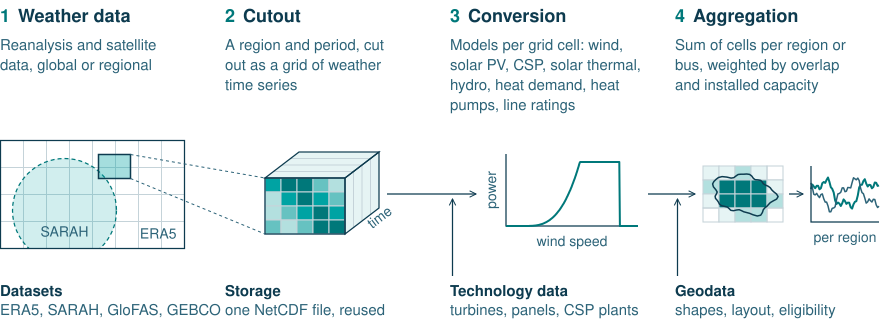

<!--
SPDX-FileCopyrightText: Contributors to atlite <https://github.com/pypsa/atlite>

SPDX-License-Identifier: CC-BY-4.0
-->

# atlite

[](https://pypi.python.org/pypi/atlite)
[](https://anaconda.org/conda-forge/atlite)
[](https://atlite.readthedocs.io/en/master/?badge=master)
[](https://github.com/PyPSA/atlite/actions/workflows/test.yaml)
[](https://codecov.io/gh/PyPSA/atlite)
[](LICENSES/MIT.txt)
[](https://api.reuse.software/info/github.com/pypsa/atlite)
[](https://github.com/astral-sh/ruff)
[](https://results.pre-commit.ci/latest/github/PyPSA/atlite/master)
[](https://doi.org/10.21105/joss.03294)
[](https://discord.gg/AnuJBk23FU)

atlite converts weather data into energy system data. It turns wind speed, solar
radiation, temperature and runoff into time series of wind and solar power, hydro
inflow, heating demand and more. atlite is free software, built on
[xarray](https://docs.xarray.dev/en/stable/) and
[dask](https://www.dask.org/). It processes large weather datasets in chunks
and therefore needs little memory.

<picture>
  <source media="(prefers-color-scheme: dark)" srcset="https://raw.githubusercontent.com/PyPSA/atlite/master/docs/assets/images/workflow_chart-dark.svg">
  
</picture>

A cutout can combine several datasets, for example ERA5 with the
higher-resolution solar radiation of SARAH. Before aggregation, atlite can also
exclude land that is not available, such as protected areas, to calculate
potentials.

## Example

This example downloads ERA5 data for Germany in January 2023. It then calculates
hourly wind capacity factors for each region in a file of region shapes:

```python
import atlite
import geopandas as gpd

cutout = atlite.Cutout(
    path="germany-2023-01.nc",
    module="era5-edh",
    x=slice(5.5, 15.5),
    y=slice(47, 55.5),
    time="2023-01",
)
cutout.prepare()

regions = gpd.read_file("regions.geojson").set_index("name")
wind = cutout.wind(
    turbine="Vestas_V112_3MW",
    shapes=regions,
    per_unit=True,
    aggregate_time=None,
)
```

The result is an `xarray.DataArray` with one time series per region. To download
ERA5 data, you need a free account; see
[ERA5 credentials](https://atlite.readthedocs.io/en/latest/home/installation/#era5-credentials).

## Installation

atlite requires Python 3.11 or newer. Install it with `conda` from
[conda-forge](https://anaconda.org/conda-forge/atlite):

```shell
conda install -c conda-forge atlite
```

or with `pip` from [PyPI](https://pypi.org/project/atlite/):

```shell
pip install atlite
```

To install the latest development version from GitHub:

```shell
pip install git+https://github.com/PyPSA/atlite.git
```

## Documentation

The [documentation](https://atlite.readthedocs.io/en/latest/) contains an
[introduction](https://atlite.readthedocs.io/en/latest/home/introduction/),
[examples](https://atlite.readthedocs.io/en/latest/examples/examples/) as
Jupyter notebooks and the
[API reference](https://atlite.readthedocs.io/en/latest/api/cutout/).

## Support and contributing

- To ask questions and talk to other users, join the
  [Discord server](https://discord.gg/AnuJBk23FU).
- To report bugs or request features, use the
  [issue tracker](https://github.com/PyPSA/atlite/issues).
- We welcome contributions. Read the
  [contributing guidelines](https://atlite.readthedocs.io/en/latest/contributing/contributing/)
  and open an issue or a pull request.

For the next development goals, see the
[roadmap](https://github.com/orgs/PyPSA/projects/12/views/1) and the open
[enhancements](https://github.com/PyPSA/atlite/issues/?q=is%3Aissue%20state%3Aopen%20label%3A%22type%3A%20enhancement%22).

## Citing

If you use atlite in your research, please cite the
[paper in the Journal of Open Source Software](https://doi.org/10.21105/joss.03294).
The [citing page](https://atlite.readthedocs.io/en/latest/home/citing/) has
the BibTeX entry.

## Origin

atlite began as a lightweight version of the Aarhus University RE Atlas
([Andresen et al., 2015](https://doi.org/10.1016/j.energy.2015.09.071)). The
Renewable Energy Group at [FIAS](https://fias.institute/) developed it for the
[CoNDyNet project (archived)](https://web.archive.org/web/20210420004051/http://condynet.de/),
funded by the [German Federal Ministry of Education and Research (BMBF)](https://www.bmftr.bund.de/EN/)
as part of the
[Stromnetze Research Initiative (archived)](https://web.archive.org/web/20190127192900/http://forschung-stromnetze.info/projekte/grundlagen-und-konzepte-fuer-effiziente-dezentrale-stromnetze/).
Today, volunteers from different institutions maintain atlite; see the
[contributors](https://atlite.readthedocs.io/en/latest/contributing/contributors/).

atlite connects meteorology and energy system modelling, two communities that
have long worked apart. Models such as [PyPSA-Eur](https://github.com/PyPSA/pypsa-eur)
use its time series.

## License

Copyright (C) Contributors to atlite <https://github.com/pypsa/atlite>

- The source code is licensed under [MIT](LICENSES/MIT.txt).
- The documentation is licensed under [CC-BY-4.0](LICENSES/CC-BY-4.0.txt).
- Configuration and data files are mostly licensed under [CC0-1.0](LICENSES/CC0-1.0.txt).

See the individual files for details.
