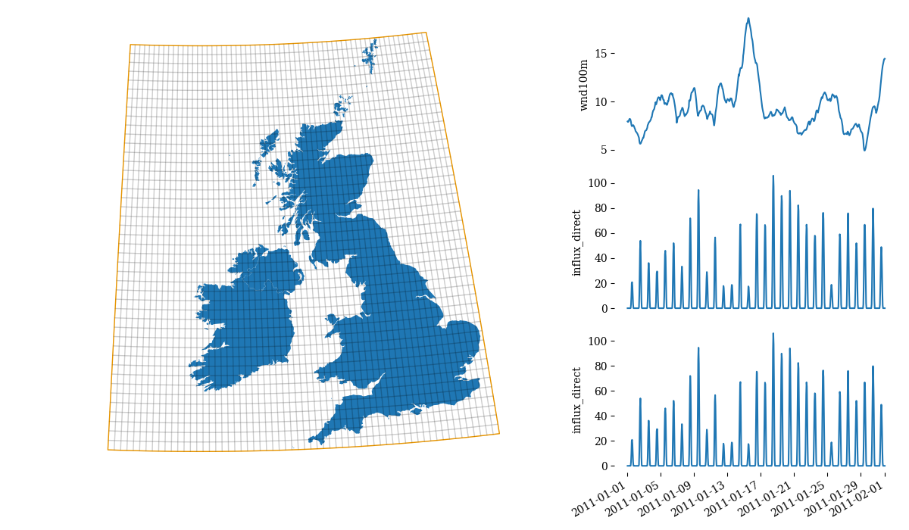
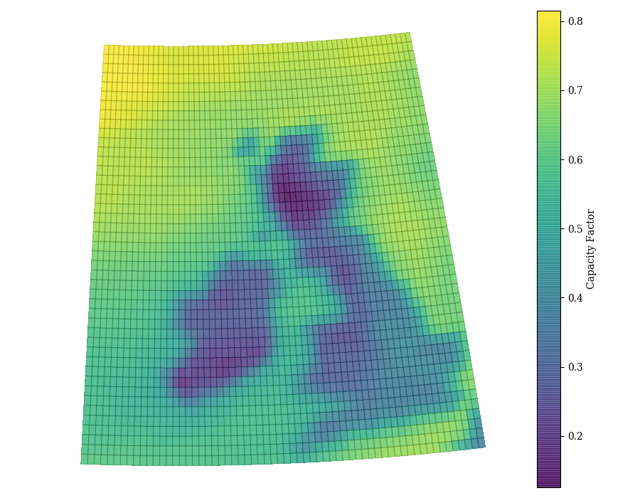
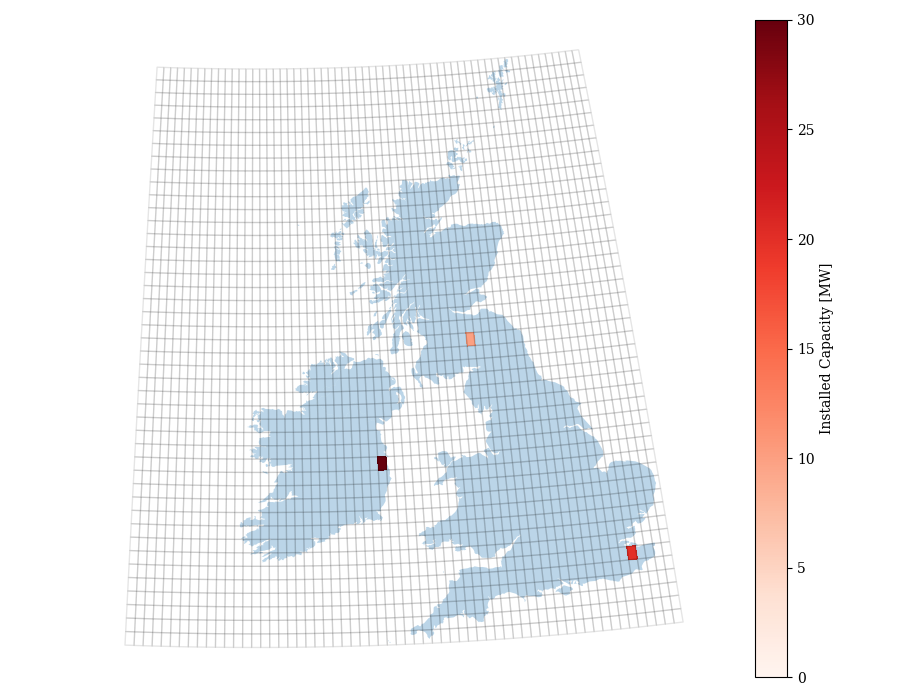
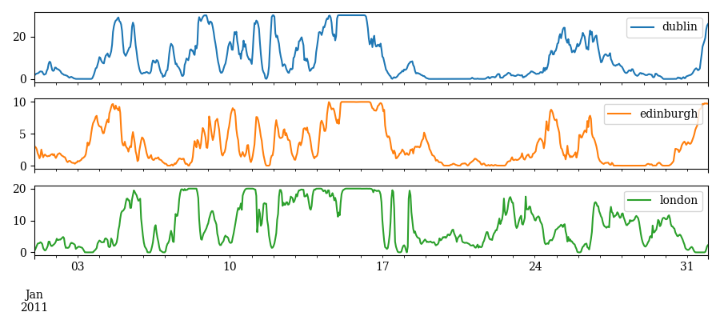
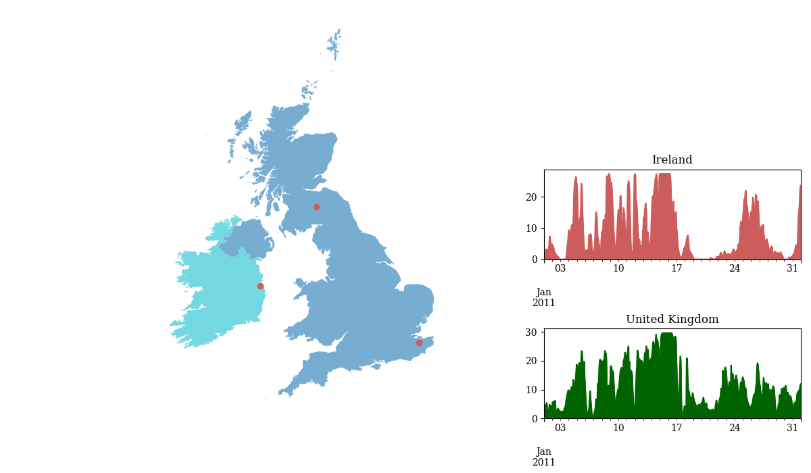
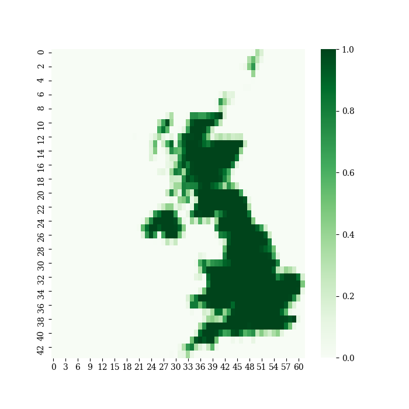

<!--
SPDX-FileCopyrightText: Contributors to atlite <https://github.com/pypsa/atlite>

SPDX-License-Identifier: CC-BY-4.0
-->

# Introduction

atlite converts weather data into quantities that energy system models need.
It creates time series for:

- **Wind** power generation, with predefined or custom turbine properties and
  optional power curve smoothing for more realistic results. Turbines can also be
  imported from the
  [Open Energy Database](https://openenergy-platform.org/dataedit/view/supply/wind_turbine_library).
- **Solar photovoltaic (PV)** power generation, with predefined or custom panel properties
  and several tracking options.
- **Concentrated solar power (CSP)** heat output from parabolic troughs and solar towers.
- **Solar thermal** heat generation from solar collectors.
- **Hydro** power generation from runoff or river discharge.
- **Heating and cooling demand**, based on the degree-day approximation.
- **Heat pump coefficients of performance**, based on air or soil temperature.
- **Dynamic line ratings** of overhead transmission lines.

## How it works

atlite starts from a global weather dataset, for example ERA5 from the
European Centre for Medium-Range Weather Forecasts (ECMWF).

From this dataset, atlite creates a **cutout**. A cutout is a spatial and temporal
subset of the original data. It contains all variables that the conversions need,
for example wind speed, solar radiation and temperature.

A cutout consists of grid cells. Each grid cell has its own weather time series.
The cell size depends on the input data; for ERA5 it is about 30 km x 30 km.
All further calculations start from the cutout.

From the cutout, you can calculate quantities per grid cell. An example is the
**capacity factor** of a wind turbine type: the average share of its rated
capacity that the turbine produces.

{ width="600" }

You can also place power plants in specific grid cells and calculate their
power output. The **capacity layout** specifies how much capacity of *one*
technology each grid cell contains. atlite includes a small
[library of wind turbine, solar panel and CSP configurations](https://github.com/PyPSA/atlite/tree/master/atlite/resources),
for example the `Vestas_V112_3MW` wind turbine.

{ width="600" }

atlite then calculates the power generation for each grid cell and aggregates it
either to buses

{ width="600" }

or to geographical shapes.

To aggregate to buses, you pass a matrix of size $N_{cell} \times N_{bus}$ that
assigns grid cells to buses. To aggregate to shapes, atlite creates this matrix
itself. This **indicator matrix** contains the spatial overlap of each grid cell
with each shape, weighted by the capacity layout if you give one. The shapes can
therefore be very detailed and even smaller than the grid cells. For the shape of
the United Kingdom, the indicator matrix without a capacity layout looks like
this:

{ width="600" }

The [plotting example](../examples/plotting_with_atlite.ipynb) creates all
figures on this page.

## What atlite does not cover

- atlite has no **graphical user interface** (GUI). You need basic knowledge of
  Python to use it.
- atlite does not **predict** generation at high resolution for a **future point in
  time**. The input data limits the spatial resolution of the results. The
  methods that translate weather data into generation, and their assumptions,
  limit the accuracy. With the current assumptions, atlite is not suited to
  predict the output of single wind turbines or solar panels.
- atlite results are theoretical and not validated per se. They are usually a
  good approximation, but they can **deviate significantly from reality**. In the
  past, datasets created with tools like atlite were often used without
  comparison to measured data. Today, it is good practice to validate them
  first, at least for plausibility. The
  [historic comparison example](../examples/historic-comparison-germany.ipynb)
  shows one way to do this.
