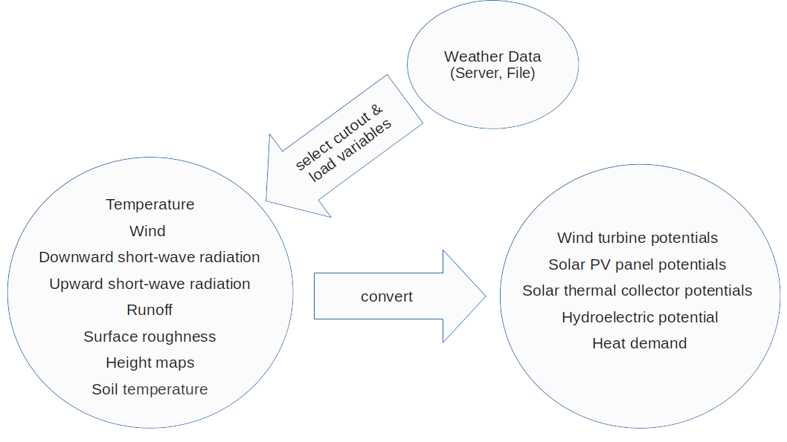

<!--
SPDX-FileCopyrightText: Contributors to atlite <https://github.com/pypsa/atlite>

SPDX-License-Identifier: CC-BY-4.0
-->

# atlite: Convert weather data to energy system data

atlite is a [free software](https://www.gnu.org/philosophy/free-sw.en.html),
[xarray](https://docs.xarray.dev/en/stable/)-based Python library. It converts
weather data, such as wind speeds, solar radiation, temperature and runoff, into
energy system data, such as wind power, solar power, hydro power and heating
demand time series. atlite works with large datasets, as is common with weather
reanalysis, but keeps computational requirements low.

The spatial and temporal resolution of the time series depends on the weather
dataset. With [ERA5](https://www.ecmwf.int/en/forecasts/datasets/reanalysis-datasets/era5),
the default dataset, atlite gives hourly time series on a grid of about
30 km x 30 km.

atlite builds a bridge between meteorology and energy system modelling.
These two communities have traditionally worked apart, and results from one
reached the other only slowly. atlite gives standard ways to access
weather and climate datasets and to convert them into weather-dependent inputs
for energy system models. Models such as
[PyPSA-Eur](https://github.com/PyPSA/pypsa-eur) and tools such as
[model.energy](https://model.energy/) use these time series.

## Quick Links

-   :material-clock-fast:{ .lg .middle } **Getting started**

    ---

    [:octicons-arrow-right-24: Introduction](home/introduction.md)

    [:octicons-arrow-right-24: Installation](home/installation.md)

    [:octicons-arrow-right-24: Create your first cutout](examples/create_cutout.ipynb)

-   :material-notebook-outline:{ .lg .middle } **Examples**

    ---

    Jupyter notebooks for cutouts, conversions and geospatial analysis.

    [:octicons-arrow-right-24: Examples](examples/examples.md)

-   :material-new-box:{ .lg .middle } **Release Notes**

    ---

    New features, bug fixes and breaking changes.

    [:octicons-arrow-right-24: What's new](release-notes.md)

-   :material-scale-balance:{ .lg .middle } **Open source, MIT**

    ---

    atlite is licensed under MIT and available on [GitHub](https://github.com/PyPSA/atlite).

    [:octicons-arrow-right-24: License](home/license.md)

## Origin and Maintainers

atlite began as a light-weight version of the Aarhus University RE Atlas
([Andresen et al., 2015](https://doi.org/10.1016/j.energy.2015.09.071)).
It has since been extended to use weather datasets simulated with projected
climate change and to compute other time series, such as hydro power, solar
thermal collectors and heating demand.

atlite was initially developed by the Renewable Energy Group at
[FIAS](https://fias.institute/) to carry out simulations for the
[CoNDyNet project (archived)](https://web.archive.org/web/20210420004051/http://condynet.de/),
financed by the [German Federal Ministry of Education and Research (BMBF)](https://www.bmftr.bund.de/EN/)
as part of the
[Stromnetze Research Initiative (archived)](https://web.archive.org/web/20190127192900/http://forschung-stromnetze.info/projekte/grundlagen-und-konzepte-fuer-effiziente-dezentrale-stromnetze/).

Today, volunteers from different institutions maintain atlite without
dedicated funding. See the [contributors](contributing/contributors.md).
For the next development goals, see the
[vision and roadmap project](https://github.com/orgs/PyPSA/projects/12/views/1)
and the list of open
[enhancements](https://github.com/PyPSA/atlite/issues/?q=is%3Aissue%20state%3Aopen%20label%3A%22type%3A%20enhancement%22).

If you use atlite in your research, please [cite it](home/citing.md).
